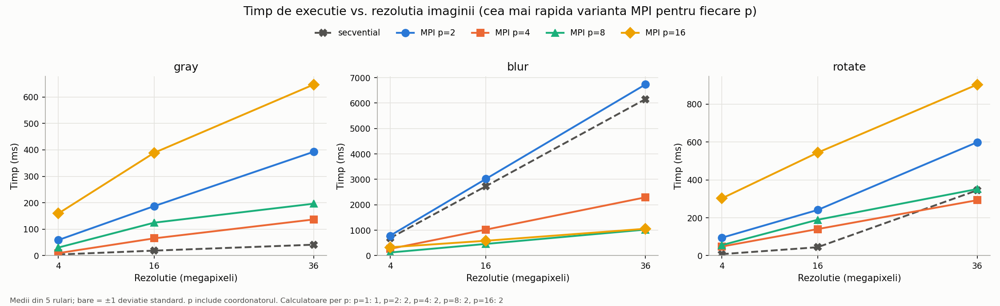
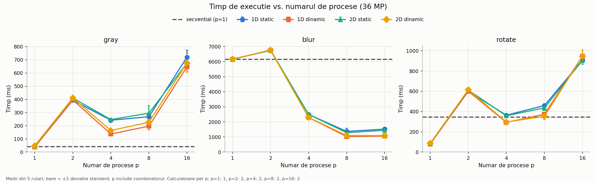
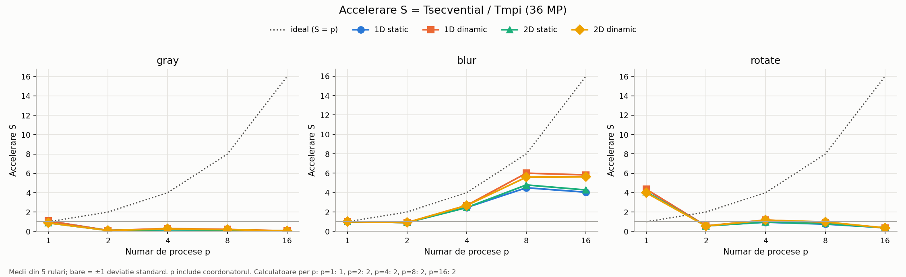

# Studiu experimental al performanței — gray, blur, rotate (MPI)

> Schelet. Secțiunile marcate cu **[DE COMPLETAT]** se completează după rularea pe cluster.

## 1. Configurația clusterului

| | Calculator 1 (rank 0) | Calculator 2 |
|---|---|---|
| Nume (hostname) | [DE COMPLETAT] | [DE COMPLETAT] |
| CPU | [DE COMPLETAT] (`lscpu`) | [DE COMPLETAT] |
| Core-uri fizice / logice (HT) | [DE COMPLETAT] | [DE COMPLETAT] |
| RAM | [DE COMPLETAT] (`free -h`) | [DE COMPLETAT] |
| OS, nativ / VM / WSL | [DE COMPLETAT] | [DE COMPLETAT] |
| MPI (`mpirun --version`) | [DE COMPLETAT] | [DE COMPLETAT] |

Rețea: [DE COMPLETAT] (de ex. Ethernet 1 Gb/s; latență `ping`; opțional lățime de bandă `iperf3`).

## 2. Metodă

- **Program:** `studiu.cpp` folosește aceleași calcule ca programele de la pct. I (`../gray.cpp`, `../blur.cpp`, `../rotate.cpp`). Blur-ul este gaussian cu raza r = 2, iar rezultatul este identic byte cu byte cu `../blur.cpp`.
- **Operații:** gray (RGB → tonuri de gri), blur gaussian (r = 2), rotate (90° în sens orar).
- **Variante:** secvențial; MPI cu divizare 1D (felii orizontale) sau 2D (grilă), fiecare cu load-balancing static (loturi ciclice fixe) sau dinamic (blocul următor merge la primul worker liber); 64 de blocuri.
- **Parametri variați:** rezoluția (4, 16, 36 MP) și numărul de procese p (1, 2, 4, 8, 16, ultima valoare peste numărul de core-uri ale clusterului). Procesele sunt distribuite alternativ pe cele două calculatoare (`--map-by node`).
- **Măsurare:** `MPI_Wtime`. Se măsoară distribuirea, calculul și colectarea, fără citirea/scrierea fișierelor. O rulare de încălzire este exclusă, apoi se face media aritmetică a 5 rulări. Fiecare rezultat MPI este verificat față de cel secvențial.
- **Indicatori:** accelerarea S = T_secvențial / T_MPI, cu baza secvențială măsurată la p = 1, și eficiența E = S / p.
- La p ≥ 2, rank 0 este coordonator și nu calculează; există p − 1 workeri.
- Configurațiile au rulat în ordine aleatoare, ca efectele de ordine (încălzire, încărcarea mașinilor) să nu favorizeze sistematic o variantă.

## 3. Rezultate

### 3.1 Timp vs. rezoluție


[DE COMPLETAT] Cum crește timpul cu numărul de pixeli: liniar? Pentru ce p este MPI mai rapid decât secvențialul?

### 3.2 Timp vs. numărul de procese


[DE COMPLETAT] Unde se plafonează timpul? Ce se întâmplă când p depășește numărul de core-uri?

### 3.3 Accelerare


[DE COMPLETAT] Cât de departe este accelerarea de cea ideală, pe fiecare operație?

### 3.4 Divizare 1D vs. 2D și static vs. dinamic
[DE COMPLETAT] Pe baza `grafice/tabel.md`: care variantă câștigă și dacă diferența depășește deviația standard.

Tabelul complet este în [grafice/tabel.md](grafice/tabel.md).

## 4. Concluzii

[DE COMPLETAT]. Ipoteze de confirmat sau infirmat cu datele:

1. **gray** și **rotate** fac foarte puțin calcul pe pixel. Costul e dominat de transferul blocurilor prin rețea, așa că accelerarea pe cluster este mică, posibil sub 1.
2. **blur** (gaussian, 25 de vecini pe pixel) are mult calcul pe octet transferat, deci ar trebui să se scaleze cel mai bine.
3. Peste numărul de core-uri disponibile, timpul nu mai scade, ba chiar crește, din cauza concurenței pentru CPU.
4. Dinamicul ajută mai ales când mașinile au puteri diferite. 1D vs. 2D diferă puțin: 2D are halo pe toate laturile, dar blocuri mai compacte.
5. Cu cât imaginea e mai mare, cu atât overhead-ul fix contează mai puțin, iar câștigul paralel e mai vizibil.

## Anexă: cum se reproduce

```bash
cd Tema1/cercetare
mpic++ -O3 -std=c++17 studiu.cpp -o studiu    # pe ambele calculatoare, aceeași cale
python3 genereaza_imagini.py                   # doar pe calculatorul 1
cp hosts.exemplu hosts                         # completați numele și slots
./ruleaza.sh                                   # scrie rezultate.txt
pip install matplotlib && python3 analiza.py rezultate.txt
```

Rezultatele preliminare (o singură mașină, 1920×1080, blur 3×3 vechi) sunt păstrate în `preliminar_1920x1080/`.
